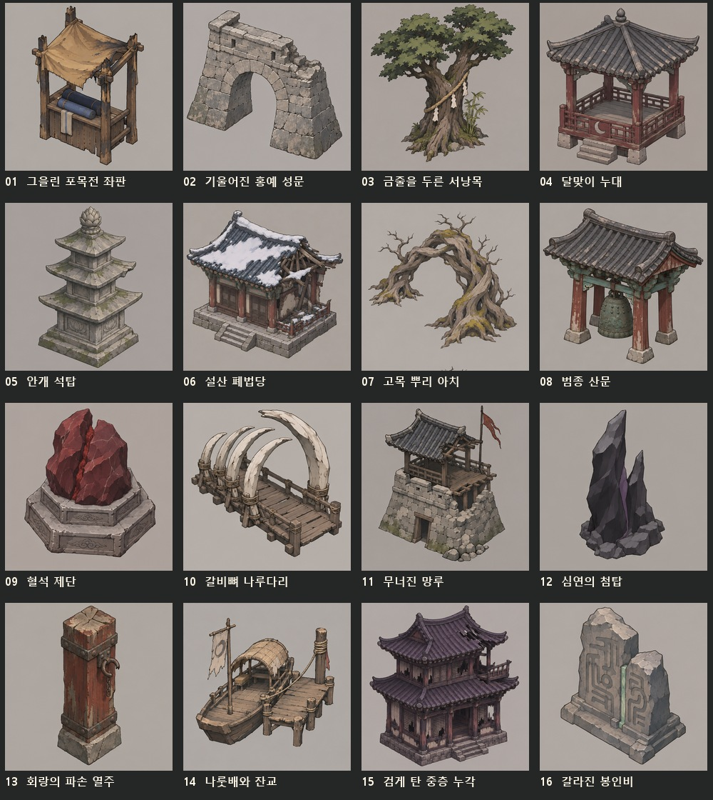

# 심안 · 장별 지형 원화



## 모델 제작에 사용하는 순서

캐릭터용 정면·후면·좌·우 입력 세트를 그대로 쓰지 않는다. 고정 쿼터뷰에서는 장터 천막, 기와지붕, 다리의 상면이 먼저 보인다. 각 시트는 한 자산의 쿼터뷰, 정면, 측면, 위쪽 형태를 한 디자인으로 묶었다. 일부 상부 뷰는 기울어져 있으므로 치수 도면으로 트레이싱하지 않는다.

1. 단일 이미지 입력 도구에는 각 폴더의 quarter.png만 넣는다. sheet.png는 네 물체가 아니라 한 물체를 설명하는 작업자용 시트다.
2. front.png에서 높이와 정면 실루엣, side.png에서 깊이, upper.png에서 처마·바닥판·돌출부를 읽는다. 좌우와 파손 방향이 애매하면 쿼터뷰를 우선한다. 후면이 필요한 도구에서 상면을 후면으로 입력하지 않는다.
3. 실제 배치 높이는 아래 표, 폭과 깊이는 게임의 기존 슬롯을 우선한다. +Y가 위, +Z가 정면이다. 다리는 바닥판과 갈비뼈를 분리해 형태를 잡고, 법당은 무너진 지붕과 드러난 서까래 사이를 막지 않는다. 회랑 열주는 같은 모델을 두 번 사용한다.
4. 베이스 컬러에 강한 명암이나 광원을 굽지 않는다. 목재·석재·기와는 큰 색면 위주로 나누고 발광은 봉인선처럼 작은 영역에만 둔다. [실제 전투 화면](../../docs/qa/stage-scenery-overview.jpg)과 [교체 규격](../../docs/stage-scenery-assets.md)을 함께 확인한다.

| 장 | 기물 / 제작 시트 | 단일 이미지 입력 | 목표 높이 |
|---|---|---|---:|
| 1 | [그을린 포목전 좌판](marketAwning/sheet.png) | [marketAwning](marketAwning/quarter.png) | 3.4 m |
| 2 | [기울어진 홍예 성문](brokenGate/sheet.png) | [brokenGate](brokenGate/quarter.png) | 6 m |
| 3 | [금줄을 두른 서낭목](bambooShrine/sheet.png) | [bambooShrine](bambooShrine/quarter.png) | 6 m |
| 4 | [달맞이 누대](moonPavilion/sheet.png) | [moonPavilion](moonPavilion/quarter.png) | 5 m |
| 5 | [안개 석탑](mistPagoda/sheet.png) | [mistPagoda](mistPagoda/quarter.png) | 7 m |
| 6 | [설산 폐법당](snowHall/sheet.png) | [snowHall](snowHall/quarter.png) | 5 m |
| 7 | [고목 뿌리 아치](rootArch/sheet.png) | [rootArch](rootArch/quarter.png) | 6 m |
| 8 | [범종 산문](bellGate/sheet.png) | [bellGate](bellGate/quarter.png) | 6 m |
| 9 | [혈석 제단](bloodAltar/sheet.png) | [bloodAltar](bloodAltar/quarter.png) | 5 m |
| 10 | [갈비뼈 나루다리](ribBridge/sheet.png) | [ribBridge](ribBridge/quarter.png) | 3 m |
| 11 | [무너진 망루](siegeTower/sheet.png) | [siegeTower](siegeTower/quarter.png) | 7 m |
| 12 | [심연의 첨탑](riftSpire/sheet.png) | [riftSpire](riftSpire/quarter.png) | 7 m |
| 13 | [회랑의 파손 열주](corridorPillar/sheet.png) | [corridorPillar](corridorPillar/quarter.png) | 6 m |
| 14 | [나룻배와 잔교](ferryJetty/sheet.png) | [ferryJetty](ferryJetty/quarter.png) | 3 m |
| 15 | [검게 탄 중층 누각](blackPavilion/sheet.png) | [blackPavilion](blackPavilion/quarter.png) | 7 m |
| 16 | [갈라진 봉인비](sealMonolith/sheet.png) | [sealMonolith](sealMonolith/quarter.png) | 6 m |

## 20종 GLB 생성

[전용 생성 스크립트](../../scripts/build_scenery.py)는 위 16종과 공용 [소나무](pine_tree/sheet.png)·[바위 군집](rock_cluster/sheet.png)·[등롱](lantern/sheet.png)·[사당](shrine/sheet.png)을 처리한다. 저장소 루트에서 실행한다.

```bash
python scripts/build_scenery.py --dry-run
python scripts/build_scenery.py --only shrine --hy3d-python "/path/to/hy3d/python" --blender "/path/to/blender"
python scripts/build_scenery.py
```

마지막 명령은 현재 Python이 로컬 Hunyuan3D 환경이고 Blender가 PATH에 있을 때 전체 생성한다. Windows에서는 위 경로 옵션에 실제 python.exe 및 blender.exe 경로를 지정해도 된다. dry-run에는 GPU가 필요 없다. 실제 생성에는 캐릭터 제작과 같은 CUDA 지원 환경, 기존 워커의 hy3dgen·torch·배경 제거·텍스처 베이킹 의존성 및 모델 가중치가 필요하다.

**캐릭터와 공통:** 배경 제거 → Hunyuan 형상 복원 → UV 및 다중 시점 텍스처 베이킹(1024px) → Blender 후처리. 원화 색을 유지하도록 delight는 생략한다.

**다른 점:** 주인공과 몬스터는 정면·후면·좌·우 입력으로 2mv를 사용한다. 이 지형물은 정면·측면·상부·쿼터뷰 구성이라 동일한 방향 세트가 아니다. 형상과 도색의 기준은 quarter.png 한 장(형상 모델 2mini)이다. 나머지 세 장은 형상 검수용이다. 상부를 후면으로 넣지 않는다. 정적 기물에는 캐릭터 골격·모션을 생성하지 않고, 바닥 중앙·높이를 맞추고 메시를 단순화한다.

**결과:** 원본은 `build/scenery/raw/<키>.glb`, 후처리본은 `build/scenery/models/<키>.glb`. 후처리만 다시 할 때는 `--skip-shape-paint --only shrine`을 쓴다. 생성 스크립트는 진행 중인 게임의 모델을 덮어쓰지 않는다. 쿼터뷰에서 앞뒤 방향, 다리·문 아래 빈 공간, 수관과 지붕의 윤곽을 대조한 뒤 [슬롯 교체 절차](../../docs/stage-scenery-assets.md)에 따라 적용한다.
