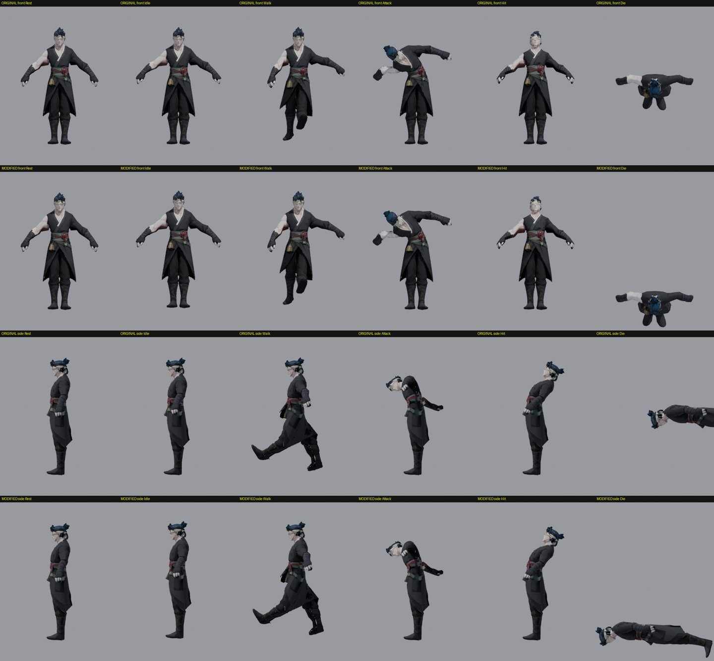
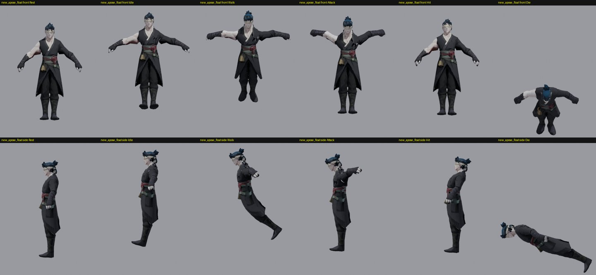
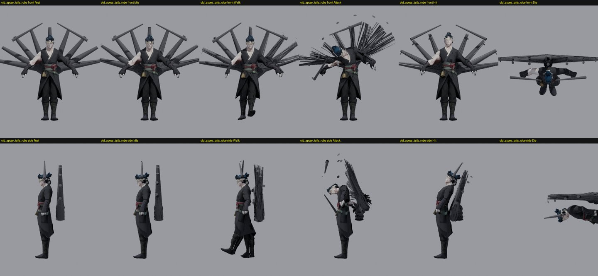
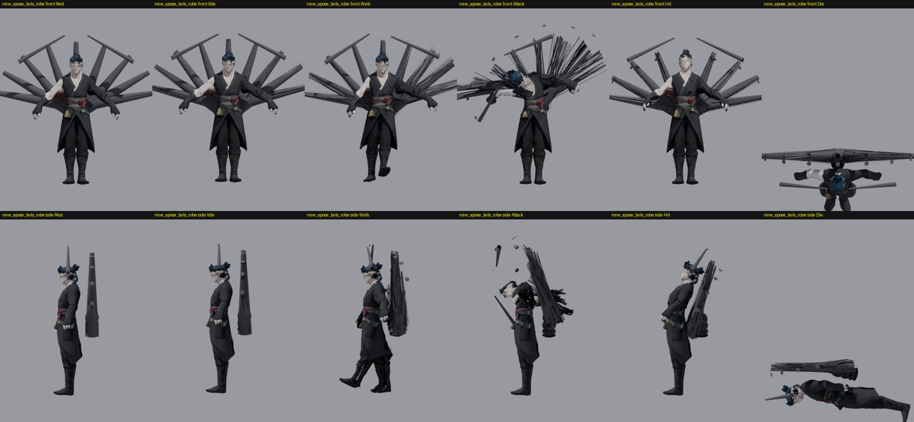

# 동양 몬스터 15종 3D 파이프라인 분석·검증 보고서

- 작성일: 2026-11-27
- 대상 커밋: `b898d07`(분석 기준), `14b8693`(수정)
- 대상 파일
  - `scripts/build_eastern_monsters.py`: 4방향 PNG → Hunyuan3D-2mv → Blender 리깅 오케스트레이터
  - `scripts/blender/rig_eastern_monster.py`: 6가지 체형별 리그, 스키닝, 5개 클립(Idle/Walk/Attack/Hit/Die)
  - `design/character-concepts/ember-eastern-monsters/<key>/{front,back,left,right}.png`: 15종 × 4방향
- 검증 환경: Linux 서버(GPU 없음)에 Blender 5.3.0 설치(`~/tools/blender-5.3.0-linux-x64`, Windows PC와 같은 버전)

---

## 1. 요약

| # | 항목 | 상태 |
|---|---|---|
| A | 4방향 입력 이미지 60장 | ✅ 바로 쓸 수 있음. 구미호 꼬리 폭 차이만 확인 필요 |
| B | 팔 본이 메시 전체 폭 기준으로 놓여 뿔·꼬리·소매에 밀림 | ✅ **수정됨** (`14b8693`) |
| C | 위아래로 움직여야 할 위치 키가 앞뒤로 움직임 (Die, 떠다니기) | ✅ **수정됨** (`14b8693`) |
| D | robe 리그에 꼬리 본이 없음 (구미호 꼬리 9개) | ❌ 미해결. 꼬리가 찢어지는 현상 재현됨 |
| E | 자동 가중치(Bone Heat)가 항상 실패하고 거리 기반 예비 가중치만 쓰임 | ⚠️ 미해결. 렌더상 큰 찢어짐은 없음 |
| F | 손 본 높이가 0.51H로 고정됨 | ⚠️ 실제 메시로 확인 필요 |
| G | Decimate 주석은 "UV 보존"인데 `delimit=UV`가 없음 | ⚠️ 미해결 |
| H | 결과 GLB 검증 단계(클립·조인트·폴리곤)와 미리보기 렌더가 없음 | ⚠️ 미해결 |
| I | 게임 연동: 결과물이 `build/`에만 있고 `glbboss.js`는 기존 모델만 불러옴 | 다음 단계 |

**아직 검증하지 못한 것:** 실제 몬스터 메시로는 테스트하지 못했습니다. Hunyuan3D에 GPU가 필요해서 이 서버에서는 몬스터 메시를 만들 수 없었기 때문입니다. 아래 검증은 모두 주인공 메시를 대신 넣은 테스트입니다(§4). B와 C처럼 메시 모양과 상관없이 생기는 **계산 버그**는 이 방법으로 확인할 수 있습니다. 하지만 구미호나 이무기왕의 **실제 결과 품질**은 이 테스트로 판단할 수 없습니다.

---

## 2. 경위 (주의: 앞선 분석 일부 폐기)

1. 처음에는 로컬 `main`이 원격보다 6커밋 뒤처진 상태였습니다. 그래서 이전 컨셉 이미지와 다른 파이프라인(`build_ember_eastern.py`, 히어로와 기존 8종용)을 분석했습니다. **그 분석은 폐기합니다.**
2. 원격의 `6826b69`(몬스터 전용 파이프라인)와 `c90b9e9`(15종 재디자인)를 기준으로 다시 분석했습니다.
3. 시트를 자르는 로직의 버그(방향마다 배율이 다름, 붙은 패널을 같은 너비로 자름)를 고쳤습니다. 그런데 이후 `c8cd28a`에서 미리 나뉜 4방향 PNG를 쓰는 방식으로 바뀌어 **시트 자르기 자체가 없어졌습니다.**
4. 팔 위치 수정은 커밋 전에 최신 코드를 받으면서 사라졌습니다. 그래서 다시 적용하고, 위치 키 수정과 함께 `14b8693`으로 커밋했습니다.

---

## 3. 입력 이미지 검사 (15종 × 4방향)

**숫자 검사** (전체 통과)
- 모두 1024×1024 RGB이고 배경은 순수한 검정 `(0,0,0)`입니다.
- 바닥선은 전부 y=962~963에 맞춰져 있습니다.
- 같은 몬스터 안에서 4방향의 키 차이는 15px 이내입니다. 장산범은 긴 옆모습에 맞춰 네 장 모두 키 559px로 들어가 있어 배율이 일관됩니다.
- 방향 규칙은 `left.png`가 화면 왼쪽, `right.png`가 오른쪽을 보는 것입니다. 기존 `ember-eastern-mv/hero_mv`와 같습니다.
- 12종은 `right.png`가 `left.png`를 좌우로 뒤집은 이미지입니다(픽셀 평균 차이 3 이하). 좌우 대칭인 몸이면 문제없습니다. 다만 백골 허리끈처럼 한쪽에만 있는 장식은 양쪽에 생깁니다.

**확인 필요**
- **구미호 꼬리 폭:** 뒷면 꼬리 폭(x 176–847, 671px)이 정면(x 257–765, 508px)보다 훨씬 넓습니다. Hunyuan3D-2mv는 4장을 합쳐 하나의 형태를 만들기 때문에, 꼬리가 뭉개질 수 있습니다.

**디자인 확인** (이전 지적사항이 해소됨)
- 도깨비는 오니 가면 대신 뿔, 상반신 노출, 호피 치마로 바뀌었습니다.
- 구미호는 여우 가면이 없어졌습니다.

---

## 4. 검증 방법

몬스터 메시를 만들 수 없어서 다음 방식으로 대신 검증했습니다.

1. **A자세 메시 만들기**
   - `v2/assets/models/hero.glb`의 `upperarm_l/r`를 50° 아래로 돌렸습니다. 새 시트처럼 A자세로 만든 것입니다.
   - 이 상태에서 메시를 굳혀 리그 없는 원본 메시로 저장했습니다.
   - 이때 원래 리그의 `hand_l/r` 위치를 **실제 손목 정답값**으로 기록했습니다.
2. **꼬리·뿔 메시 만들기**
   - 위 메시에 도깨비처럼 넓은 뿔 2개를 붙였습니다.
   - 구미호처럼 몸 뒤로 부채꼴 꼬리 9개를 붙였습니다. 꼬리는 세분화해서 정점을 많이 만들었습니다.
3. **같은 메시로 원래 스크립트와 수정 스크립트 비교**
   - 원래 스크립트(`b898d07` 버전)와 수정 스크립트(`14b8693`)로 같은 메시를 리깅했습니다.
   - 측정 항목
     - `hand_l` 본 위치와 정답 손목 위치의 차이
     - 각 클립에서 골반 본의 월드 좌표 변화(앞뒤 y, 위아래 z)
   - 렌더: 정면과 옆면에서 Rest, Idle(f20), Walk(f13), Attack(f15), Hit(f5), Die(f18)를 Cycles CPU로 렌더링했습니다.

테스트 스크립트와 원본 렌더는 서버의 `/tmp/bt/`에 있습니다(임시). 아래 표에 나오는 이미지는 `docs/qa/eastern-monsters-rig/`에 보관했습니다.

---

## 5. 수정 내용과 검증 결과

### B. 팔 본 위치 (`import_and_prepare_mesh`, `build_armature`)

**원인**
- 팔 위치를 `arm_x = max(sh_x + 0.18H, W * 0.44)`로 계산하는데, W는 메시 전체의 폭입니다.
- 그래서 뿔, 꼬리, 넓은 소매가 있으면 손 본이 실제 손보다 바깥에 놓입니다.

**수정**
- 높이 0.45H~0.82H 구간(어깨에서 손까지)에서, 몸 앞쪽 절반(y ≤ 중앙값)에 있는 정점만으로 폭을 잽니다. 튀는 정점은 98번째 백분위로 걸러냅니다.
- 이렇게 잰 `arm_w`를 humanoid, robe, float, serpent 리그에 씁니다.
- avian(날개)과 quadruped(다리 간격) 리그는 원래대로 전체 폭 W를 씁니다.

**결과**

| 메시 | 원래 스크립트의 손 x 오차 | 수정 후 손 x 오차 |
|---|---|---|
| A자세 | +0.074m | +0.052m |
| A자세 + 뿔 + 꼬리 9개 | **+0.346m** | **+0.038m** |

빌드 로그에 `Arm span X.XXm (full bbox width Y.YYm)`이 출력되므로, 실제 몬스터를 빌드할 때도 이 두 값을 비교해 확인할 수 있습니다.

### C. 위치 키 방향 (`set_pose_key`)

**원인**
- 애니메이션 위치 값은 "(0, 0, dz) = 위아래"라는 월드 기준으로 적혀 있습니다.
- 그런데 Blender의 `pose_bone.location`은 본 자체의 좌표축 기준입니다. 위를 향하는 pelvis와 body 본에서는 z가 월드 앞뒤 방향(y)이 됩니다.

**수정**
- 키를 넣기 전에 `pb.bone.matrix_local.to_3x3().inverted() @ offset`으로 월드 기준 값을 본 기준 값으로 바꿉니다.
- 적혀 있는 애니메이션 숫자는 바꾸지 않았습니다.

**결과** (골반 본 월드 좌표 변화)

| 클립 | 원래 스크립트 | 수정 후 |
|---|---|---|
| humanoid Die f18 | 앞뒤 **+0.814m**, 위아래 0 | 앞뒤 0, 위아래 **−0.814m** |
| humanoid Idle f20 | 앞뒤 −0.028m | 위아래 +0.028m |
| float Idle f20 | 앞뒤 −0.111m | 위아래 +0.111m |
| float Walk f13 | 앞뒤 −0.105m | 위아래 +0.105m |

**같은 입력으로 비교한 렌더** (`01_original_vs_modified_same_apose_mesh.jpg`)
- **Die를 뺀 모든 클립이 동일합니다.** 즉 수정 때문에 나빠진 클립은 없습니다.
- Die의 경우, 원래 스크립트에서는 몸이 허리 높이에 수평으로 떠 있습니다. 수정 후에는 바닥에 쓰러집니다.





---

## 6. 미해결 문제

### D. 꼬리 본 없음 (구미호, 이무기왕의 뿔·장식)
- robe 리그는 19본 사람형이라 꼬리 본이 없습니다.
- 그래서 꼬리 정점이 가장 가까운 팔, 척추, 다리 본에 붙습니다.
- 그 결과 Walk와 Attack에서 꼬리가 늘어나고 찢어집니다(`03_modified_tails_antlers_robe.jpg`). 뿔 끝도 Attack 때 조각나 흩어집니다. 이 문제는 B·C 수정과 상관없이 원래 스크립트에도 똑같이 있습니다(`02_…`).
- 해결 방향은 두 가지입니다.
  - (a) robe 리그에 꼬리 체인 본을 추가합니다.
  - (b) 꼬리를 골반에 고정 가중치로 붙이고, 흔들림은 게임 코드에서 만듭니다.
- 실제 구미호 메시를 보고 정하는 것이 좋습니다.




### E. 자동 가중치(Bone Heat) 실패
- 모든 테스트에서 `Bone Heat Weighting: failed to find solution`이 떴습니다. 그래서 모든 정점이 `fallback_verts`, 즉 거리 기반 상위 3개 본 가중치로 처리됐습니다.
- glTF로 불러온 메시는 UV 경계마다 정점이 갈라져 있어서 이렇게 되는 것으로 보입니다. Hunyuan 메시도 같은 방식이라 같은 결과가 나올 가능성이 큽니다.
- 렌더상 몸통과 팔다리에 큰 찢어짐은 없습니다. 개선하려면 가중치를 계산하기 전에 Merge by Distance로 정점을 합친 뒤 계산하고, 결과를 원래 메시로 옮기는 방법이 있습니다.

### F. 손 본 높이 고정 (0.51H)
- 대체 메시는 실제 손목이 0.57H인데 손 본은 0.51H에 놓여 0.11m 낮았습니다.
- 새 시트의 몬스터는 팔을 더 내리고 있어서 0.51H에 가까울 수 있습니다. 실제 메시로 확인해야 합니다.
- 필요하면 B처럼 메시에서 손목 높이를 재도록 바꿉니다.

### G. Decimate UV 경계
- 주석에는 "preserving UV seams"라고 되어 있지만 `delimit = {"UV"}`가 없습니다. 폴리곤을 줄일 때 UV 경계가 무너져 텍스처가 번질 수 있습니다.
- 다만 Hunyuan 단계(`FaceReducer`)에서 이미 폴리곤을 줄이기 때문에, 영향은 실제 메시로 확인해야 합니다.

### H. 결과 검증과 미리보기 없음
- 이전 파이프라인(`build_ember_eastern_m2m.py`)에 있던 `verify_export`(클립, 조인트, 가중치 확인)와 `--preview` 렌더가 없습니다.
- 이번 B·C 같은 문제는 눈으로 보기 전까지 발견할 수 없었습니다. 이번에 만든 측정·렌더 스크립트를 `--preview` 옵션으로 넣는 것을 추천합니다.

### 기타 관찰
- **Attack과 Hit 동작:** 두 스크립트 모두 Attack은 상체가 옆으로 크게 꺾이고 Hit은 머리가 뒤로 많이 젖혀집니다. 키 값을 조정할 대상입니다.
- **방향 보정 옵션:** `--rot-z-deg` 옵션이 있지만 `build_eastern_monsters.py`가 넘기지 않습니다. Hunyuan 모델이 다른 방향을 보고 나오면 보정할 방법이 없습니다.
- **키 값:** 게임이 모델 높이를 다시 맞추기 때문에(`glbboss.js:176`), `MONSTERS`의 키 값은 게임 안 크기에 반영되지 않습니다.

---

## 7. 다음 단계

1. **실제 메시로 검증 (GPU 필요):** Windows PC에서 아래 명령으로 Hunyuan 단계만 돌린 뒤, `build/eastern_monsters/raw/*.glb`를 서버로 올립니다.
   ```
   python scripts/build_eastern_monsters.py --only gumiho_boss --skip-blender
   python scripts/build_eastern_monsters.py --only changgui_zombie --skip-blender
   python scripts/build_eastern_monsters.py --only dokkaebi_boss --skip-blender
   ```
   올리면 서버에서 리깅, 측정, 렌더로 D, E, F, G를 확인합니다.
2. **D 해결 방식 결정:** 꼬리 체인 본을 추가할지, 골반 고정과 코드 흔들림으로 갈지 정합니다.
3. **H 추가:** 검증·미리보기를 파이프라인에 넣습니다.
4. **I 게임 연동:** `glbboss.js`, `art.js`의 몬스터 매핑과 스테이지별 배치를 정합니다.
