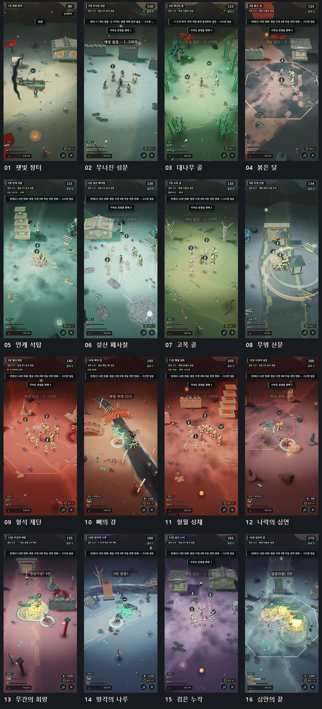

# 16장 전장과 제스처 전투: 변경 및 플레이 검증

기존 세이브로 플레이할 때도 각 장에 들어가면 새 전장이 표시된다. 지형 배치가 달라졌지만 일반 출전과 획 입력 방법은 바뀌지 않았다.

## 플레이에서 달라진 점

- 장터와 무너진 성문은 같은 색으로 바닥만 바꾸지 않는다. 장터는 비스듬한 길을 따라 좌판과 기와집이 늘어서고, 성문은 중앙 진입로 뒤에 문과 성벽이 보인다. 후반부 뼈의 강은 낮은 뼈다리로 물길을 표시하고, 마지막 장은 봉인비와 팔각 뜰을 중심으로 열린 결전장을 만든다.
- 높은 기물은 주로 뒤와 양옆에, 낮은 파편과 풀은 전경에 놓아 검객·적·획이 보일 공간을 남겼다. 길 가장자리는 배경에 섞이게 하고, 설산 지붕에는 눈색을 적용했다.
- 첫 출전은 전투 리소스가 준비된 후 시작하며 초기화 실패를 한 판으로 기록하지 않는다. 획 미리보기와 최종 조준은 같은 보정 방식을 사용한다. 수련장에는 최근 입력 결과와 패링 타이밍의 빠름·늦음이 표시된다.

## 모델 제작 및 교체

[배치 명세](../../v2/js/modules/stageScenery.js)가 장별 노면·경로·기물 위치를 정한다. 현재는 기존 모델과 절차형 기물로 전 장을 플레이할 수 있다. 전용 모델은 16종으로, 13장의 열주는 같은 모델을 두 곳에 쓴다. [전체 제작 목록과 교체 절차](../stage-scenery-assets.md)에 장별 파일명·목표 높이·대체물을 정리했다.

## 검증 기록

| 검증 | 결과 |
|---|---|
| 가로 화면 900×640, 대표 4개 장 | 실제 출전·획 입력으로 길 끝과 설산 지붕의 문제를 찾아 수정했다. |
| 세로 화면 390×844, 1~16장 | 장마다 전투에 진입해 화면과 장별 기물 5곳을 확인했다. 최종 전 장 순회에서 획 20회가 등록됐다. |
| 목표 HUD | 9장 세로 화면에서 장 이름·임무·특수 목표의 영역이 겹치지 않음을 확인했다. |
| 모델 교체 | 장터 슬롯에 기존 사당 GLB를 연결하면 임시 기물이 숨고, 성문 슬롯에 없는 파일을 지정하면 임시 성문이 남았다. |
| 회귀 검사 | 저장소 루트에서 `node tests/unit/modules.test.mjs` 실행. 기존 모듈 및 신규 16장 배치·공용 모델 검사를 통과했다. |

검증은 브라우저 기준이다. 실제 휴대폰의 프레임률과 16개 장 전체 클리어는 측정하지 않았다. 별도 제스처 표본에서는 기존 기준과 반달 45획의 인식 결과가 달랐으며, 이번 변경으로 그 차이가 해소된 것은 아니다.
